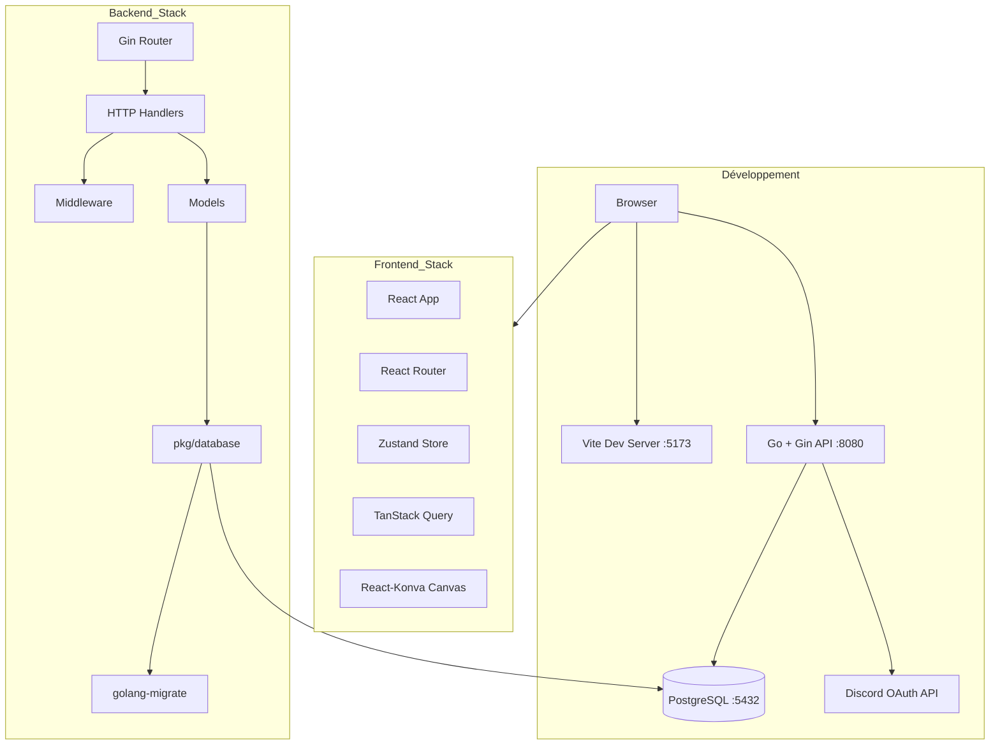
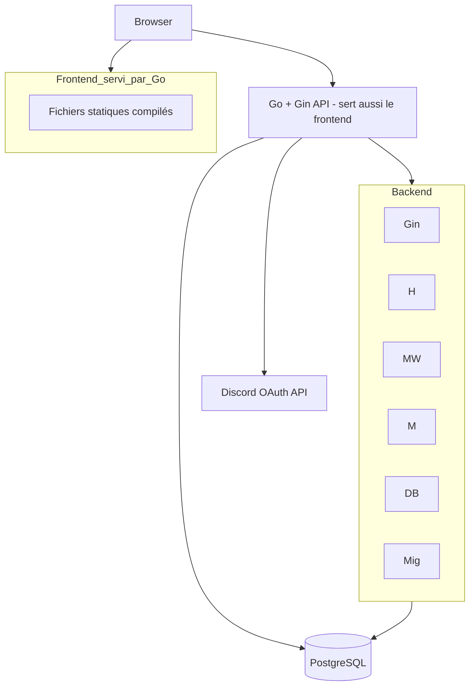

# Architecture technique

## Diagramme d'architecture (développement)

## Diagramme d'architecture (production)

## Description des couches

- **Frontend** : React 19 + TypeScript, Vite en développement / servi par Go en production
- **Backend** : Go 1.26 + Gin (API REST)
- **Base de données** : PostgreSQL 16
- **Migrations** : golang-migrate

## Flux de données

Client → Gin Router → Middleware → Handler → Models → Database → PostgreSQL

## Patterns

- **MVC / MVVM** : Architecture inspirée modèle-vue-contrôleur
- **Repository pattern** : Accès à la base de données via `pkg/database`
- **Middleware chain** : Sécurité et logging via la chaîne de middlewares Gin
