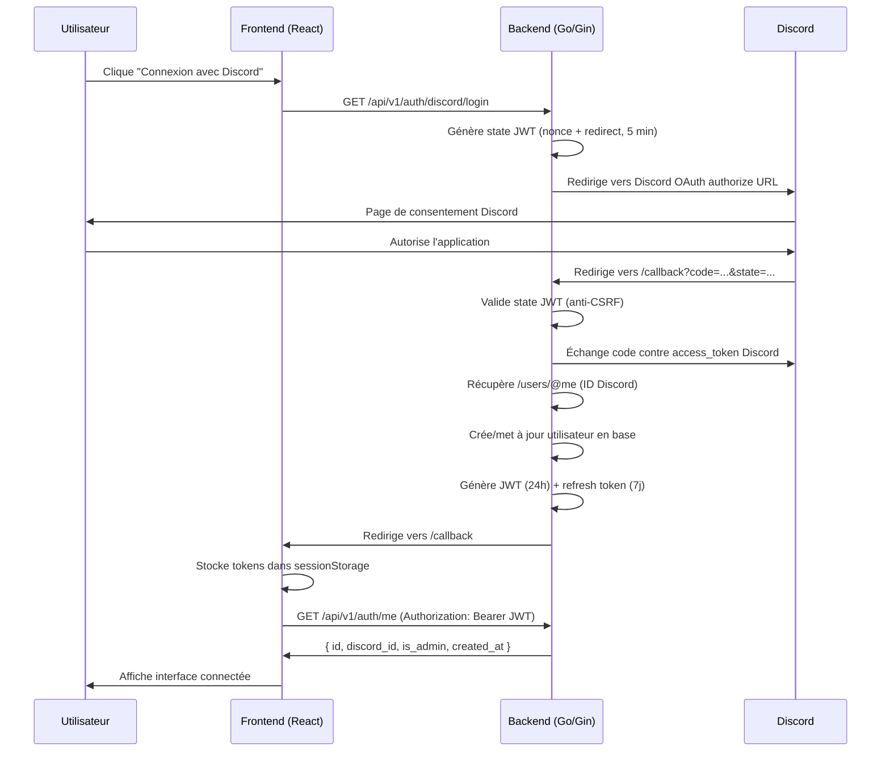
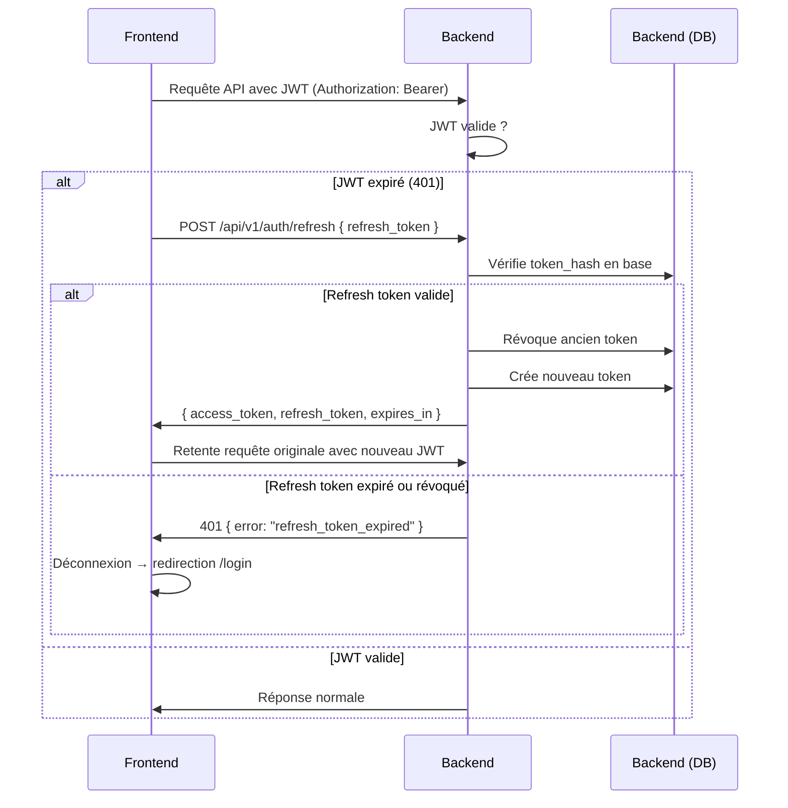
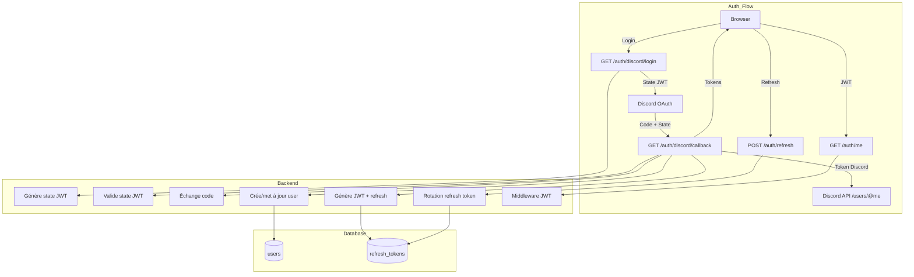

# Authentification Discord

## Vue d'ensemble

Eva Trainer utilise **Discord OAuth2** pour l'authentification des utilisateurs. Le système repose sur un flux **OAuth2 Authorization Code** combiné à des **JWT** pour les sessions et des **refresh tokens avec rotation** pour le renouvellement.

Le schéma ci-dessous résume le parcours complet :



### Flux avec refresh



## Configuration

### Application Discord

1. Créer une application sur [Discord Developer Portal](https://discord.com/developers/applications)
2. Aller dans **OAuth2 → Redirects** et ajouter l'URL correspondant à `DISCORD_REDIRECT_URL` (ex: `http://localhost:8080/api/v1/auth/discord/callback`)
3. Scopes OAuth2 requis : `identify` uniquement
4. Générer un **Client ID** et un **Client Secret**

### Variables d'environnement

Les variables complètes sont documentées dans [`docs/configuration.md`](./configuration.md).  
Seules les variables liées à l'authentification sont listées ci-dessous :

| Variable | Obligatoire | Défaut | Description |
|----------|-------------|--------|-------------|
| `DISCORD_CLIENT_ID` | Oui | — | Client ID de l'application Discord |
| `DISCORD_CLIENT_SECRET` | Oui | — | Client Secret Discord |
| `DISCORD_REDIRECT_URL` | Oui | — | URL complète de callback (ex: `http://localhost:8080/api/v1/auth/discord/callback`) |
| `SERVER_FRONTEND_URL` | Oui | `http://localhost:5173` | URL de base du frontend pour les redirections (dev: port Vite, prod: même origine) |
| `JWT_SECRET` | Oui | — | Clé HMAC pour signer les JWT (minimum 32 caractères recommandé) |
| `JWT_EXPIRY` | Non | `24h` | Durée de validité du JWT (format Go [`time.ParseDuration`](https://pkg.go.dev/time#ParseDuration)) |
| `REFRESH_TOKEN_EXPIRY` | Non | `168h` (7j) | Durée de validité du refresh token |

> La variable `SERVER_FRONTEND_URL` n'apparaît pas dans `.env.example`. Ajoutez-la manuellement si la valeur par défaut ne convient pas (décision Q4).

## Endpoints API

### GET /api/v1/auth/discord/login

Redirige vers la page d'autorisation Discord. Un **state JWT** est généré côté backend (HMAC-SHA256, expire en 5 minutes) et embarqué dans la redirection. Ce state contient un nonce aléatoire et le chemin de redirection d'origine (décision Q5).

**Réponse :** `302 Redirect` vers l'URL d'autorisation Discord.

**Exemple :**

```bash
curl -v http://localhost:8080/api/v1/auth/discord/login
```

### GET /api/v1/auth/discord/callback?code=...&state=...

Callback appelé par Discord après autorisation de l'utilisateur.

1. Le backend valide le state JWT (signature + expiration 5 min)
2. Échange le `code` contre un `access_token` Discord
3. Récupère l'ID Discord via `GET https://discord.com/api/v10/users/@me`
4. Crée ou met à jour l'utilisateur en base de données
5. Génère un JWT (24h) + refresh token (7j) avec rotation
6. Redirige vers le frontend avec les tokens dans le **fragment URL** (décision Q2)

**Réponse :** `302 Redirect` vers `{SERVER_FRONTEND_URL}/callback#access_token=...&refresh_token=...&expires_in=86400&redirect=/`

| Paramètre hash | Description |
|----------------|-------------|
| `access_token` | JWT (24h) à utiliser dans le header `Authorization: Bearer` |
| `refresh_token` | Token de rafraîchissement (7j, usage unique avec rotation) |
| `expires_in` | Durée de vie du JWT en secondes |
| `redirect` | Chemin de redirection post-connexion (défaut: `/`) |

**Exemple :**

```bash
curl -v "http://localhost:8080/api/v1/auth/discord/callback?code=MOCK_CODE&state=MOCK_STATE"
```

### POST /api/v1/auth/refresh

Rafraîchit le JWT. Le refresh token est **révoqué** et un nouveau est généré (rotation anti-replay).

**Body :**

```json
{
  "refresh_token": "a1b2c3d4e5f6..."
}
```

**Réponse (200) :**

```json
{
  "access_token": "eyJhbGciOiJIUzI1NiIs...",
  "refresh_token": "f6e5d4c3b2a1...",
  "expires_in": 86400
}
```

**Réponse (401) :**

```json
{
  "error": "refresh_token_expired",
  "message": "Refresh token has expired. Please login again."
}
```

**Exemple :**

```bash
curl -X POST http://localhost:8080/api/v1/auth/refresh \
  -H "Content-Type: application/json" \
  -d '{"refresh_token": "votre_refresh_token"}'
```

### GET /api/v1/auth/me

Retourne les informations de l'utilisateur actuellement connecté.

**Headers :** `Authorization: Bearer <jwt>`

**Réponse (200) :**

```json
{
  "id": 1,
  "discord_id": "123456789012345678",
  "is_admin": false,
  "created_at": "2025-01-15T10:30:00Z"
}
```

**Exemple :**

```bash
curl http://localhost:8080/api/v1/auth/me \
  -H "Authorization: Bearer votre_jwt"
```

### Tableau récapitulatif des endpoints

| Méthode | Chemin | Authentification | Body | Réponse |
|---------|--------|-----------------|------|---------|
| `GET` | `/api/v1/auth/discord/login` | Non | — | `302 Redirect` vers Discord |
| `GET` | `/api/v1/auth/discord/callback` | Non (state JWT) | Query: `code`, `state` | `302 Redirect` vers frontend avec tokens |
| `POST` | `/api/v1/auth/refresh` | Non (refresh token) | `{ "refresh_token": "..." }` | `200` + nouveaux tokens |
| `GET` | `/api/v1/auth/me` | Bearer JWT | — | `200` + utilisateur |

## Modèle de données

### Table `users`

Définie dans [`docs/specification/database_schema.md`](./specification/database_schema.md).

```sql
CREATE TABLE users (
    id         SERIAL PRIMARY KEY,
    discord_id VARCHAR(255) UNIQUE NOT NULL,
    is_admin   BOOLEAN DEFAULT FALSE,
    created_at TIMESTAMP DEFAULT NOW(),
    updated_at TIMESTAMP DEFAULT NOW()
);
```

> **Premier utilisateur** : Le premier utilisateur à se connecter est automatiquement promu `is_admin = true`.

### Table `refresh_tokens`

Stocke les refresh tokens **hashés en SHA-256**. Le token brut n'est connu que du client ; la base ne contient jamais le token en clair.

```sql
CREATE TABLE refresh_tokens (
    id         SERIAL PRIMARY KEY,
    user_id    INTEGER NOT NULL REFERENCES users(id) ON DELETE CASCADE,
    token_hash VARCHAR(64) UNIQUE NOT NULL,
    expires_at TIMESTAMP NOT NULL,
    created_at TIMESTAMP DEFAULT NOW(),
    revoked_at TIMESTAMP
);

CREATE INDEX idx_refresh_tokens_user ON refresh_tokens(user_id);
CREATE INDEX idx_refresh_tokens_hash  ON refresh_tokens(token_hash);
```

## Flux détaillé

### Connexion (étapes complètes)

| Étape | Acteur | Action | Détail |
|-------|--------|--------|--------|
| 1 | Utilisateur | Clique "Connexion avec Discord" | Frontend appelle `GET /api/v1/auth/discord/login` |
| 2 | Backend | Génère state JWT | JWT signé HMAC-SHA256, contient `nonce` + `redirect_path`, expire en 5 min |
| 3 | Backend | Redirige vers Discord | Construit l'URL OAuth2 avec `client_id`, `redirect_uri`, `state` et scope `identify` |
| 4 | Utilisateur | Autorise l'application | Page de consentement Discord |
| 5 | Discord | Redirige vers callback | `GET /api/v1/auth/discord/callback?code=...&state=...` |
| 6 | Backend | Valide le state | Vérifie signature HMAC et expiration du state JWT (anti-CSRF) |
| 7 | Backend | Échange le code | `POST https://discord.com/api/v10/oauth2/token` avec `client_id`, `client_secret`, `code` |
| 8 | Backend | Récupère l'utilisateur Discord | `GET https://discord.com/api/v10/users/@me` avec le token Discord |
| 9 | Backend | Crée/met à jour utilisateur | `INSERT ... ON CONFLICT (discord_id) DO UPDATE` |
| 10 | Backend | Génère JWT | HMAC-SHA256, `sub` = user ID, `exp` = now + JWT_EXPIRY |
| 11 | Backend | Génère refresh token | 32 bytes aléatoires → 64 chars hex, stocké hashé (SHA-256) |
| 12 | Backend | Redirige vers frontend | `302` vers `{SERVER_FRONTEND_URL}/callback#access_token=...&refresh_token=...` (décision Q2) |
| 13 | Frontend | Lit le fragment URL | Parse `window.location.hash` |
| 14 | Frontend | Stocke en sessionStorage | Clés : `eva_access_token`, `eva_refresh_token` (décision Q3) |
| 15 | Frontend | Charge l'utilisateur | `GET /api/v1/auth/me` avec le JWT |
| 16 | Frontend | Redirige | Vers le chemin `redirect` (ou `/` par défaut) |

### Rafraîchissement de session

1. Le client reçoit un `401` sur une requête API
2. Le client vérifie la présence d'un refresh token en sessionStorage
3. Si absent → déconnexion immédiate → redirection `/login`
4. Si présent → `POST /api/v1/auth/refresh` avec le refresh token
5. Le backend hache le token reçu et le compare en base
6. Si hash trouvé + non expiré + non révoqué :
   - Révoque l'ancien token (`revoked_at = NOW()`)
   - Crée un nouveau refresh token
   - Retourne `{ access_token, refresh_token, expires_in }`
7. Si hash non trouvé, expiré, ou révoqué → `401` → déconnexion
8. Le client met à jour les tokens dans sessionStorage
9. Le client retente la requête originale avec le nouveau JWT

## Sécurité

### State OAuth (anti-CSRF)

Le paramètre `state` de l'OAuth2 est un **JWT signé** avec `JWT_SECRET` (HMAC-SHA256). Il contient :
- `nonce` : chaîne aléatoire (16 bytes → 32 chars hex)
- `redirect_path` : chemin de redirection post-connexion

**Validité :** 5 minutes. Un state expiré retourne une erreur `400 invalid_state`.

**Pourquoi JWT plutôt qu'un token opaque ?** (décision Q5)
- Pas de stockage en base (le state est éphémère)
- Vérifiable sans accès à la base de données
- Le nonce limite le replay même dans la fenêtre de 5 min

### JWT

- **Algorithme :** HMAC-SHA256 (`HS256`)
- **Durée :** `JWT_EXPIRY` (défaut 24h)
- **Claims :**
  - `sub` : ID de l'utilisateur (colonne `users.id`)
  - `exp` : timestamp d'expiration
  - `iat` : timestamp d'émission
- **Validation :** signature vérifiée sur chaque requête protégée via le middleware Gin

### Refresh tokens

- **Génération :** 32 bytes aléatoires (crypto/rand) → 64 caractères hex
- **Stockage :** Hashé en SHA-256 (`token_hash`). La base ne contient jamais le token brut
- **Rotation :** Chaque utilisation du refresh token le révoque et en crée un nouveau
- **Expiration :** `REFRESH_TOKEN_EXPIRY` (défaut 7 jours) stockée dans `expires_at`
- **Révocation :** Tous les refresh tokens d'un utilisateur sont révoqués à la reconnexion Discord

### SessionStorage (côté frontend)

Les tokens sont stockés en **sessionStorage** (décision Q3) :
- **Perdus à la fermeture du navigateur** : pas de session persistante entre les sessions de navigation
- **Protégés contre les attaques CSRF** : sessionStorage est isolé par origine, inaccessible via les cookies
- **Pas de cookie HttpOnly** : le JWT est utilisé en header `Authorization`, pas en cookie, ce qui évite les attaques CSRF classiques

**Pourquoi pas localStorage ?** localStorage persiste indéfiniment, ce qui augmenterait la fenêtre d'exposition en cas de XSS. sessionStorage limite l'exposition à la durée de l'onglet.

### Flux de déconnexion

1. L'utilisateur clique "Déconnexion"
2. Le frontend vide `sessionStorage`
3. Le frontend redirige vers `/login`
4. Les refresh tokens ne sont pas révoqués côté serveur (ils expirent naturellement)

> À noter : une future amélioration pourrait ajouter un endpoint `POST /api/v1/auth/logout` pour révoquer tous les refresh tokens côté serveur.

## Gestion des erreurs

| Code HTTP | `error` | Message anglais | Message français (frontend) | Cause |
|-----------|---------|-----------------|----------------------------|-------|
| 400 | `invalid_state` | State JWT is invalid or expired | State invalide ou expiré | State JWT manquant, mal formé, ou expiré (5 min) |
| 401 | `invalid_authorization_code` | Invalid authorization code | Code d'autorisation invalide | Code Discord échangé deux fois ou invalide |
| 401 | `unauthorized` | Missing or invalid authorization header | Token manquant ou invalide | Header `Authorization` absent ou mal formé |
| 401 | `refresh_token_expired` | Refresh token has expired | Session expirée, reconnectez-vous | Refresh token a dépassé `expires_at` |
| 401 | `refresh_token_revoked` | Refresh token has been revoked | Session expirée, reconnectez-vous | Refresh token déjà utilisé (replay détecté) |
| 502 | `discord_api_error` | Unable to reach Discord API | Connexion impossible | API Discord indisponible ou timeout |

### Scénarios d'erreur détaillés

#### Discord indisponible (502)

Si l'API Discord est injoignable lors d'une tentative de connexion, le backend retourne une erreur `502` avec le message "connexion impossible". Le frontend affiche ce message sur la page de login.

#### State OAuth expiré

Si l'utilisateur prend plus de 5 minutes entre le clic sur "Connexion avec Discord" et l'autorisation, le state JWT expire. Le callback retourne une erreur `400 invalid_state`. L'utilisateur doit recommencer la connexion.

#### Refresh token expiré ou révoqué (décision Q7)

Un refresh token expiré ou déjà utilisé retourne `401 refresh_token_expired` ou `401 refresh_token_revoked`. Le frontend :
1. Vide sessionStorage
2. Redirige vers `/login` (pas de refresh automatique)
3. L'utilisateur doit se reconnecter via Discord

#### Code Discord invalide

Un code d'autorisation Discord ne peut être échangé qu'une seule fois. Si le callback est appelé deux fois avec le même code, Discord retourne une erreur. Le backend traduit en `401 invalid_authorization_code`.

## Tests

### Stratégie

Les tests d'authentification utilisent **testcontainers-go** pour lancer PostgreSQL dans un conteneur Docker (décision Q6).

### Fichiers de test

| Fichier | Type | Description |
|---------|------|-------------|
| `internal/models/user_test.go` | Unitaire | CRUD utilisateur, hash Discord ID |
| `internal/models/refresh_token_test.go` | Unitaire | Création, validation, rotation, expiration des refresh tokens |
| `internal/handlers/auth_test.go` | Intégration | Flux complet login → callback → me → refresh |

### Ce que les tests couvrent

- Création et récupération d'utilisateurs
- Hash et validation des refresh tokens
- Rotation : l'ancien token est révoqué après utilisation
- Expiration : un token expiré retourne une erreur
- Flux OAuth2 complet (state JWT → code → token → /me)
- Comportement en cas de refresh token invalide (401)
- Premier utilisateur promu admin

### Exécution

```bash
# Tests unitaires
go test ./internal/models/ -v

# Tests d'intégration (nécessite Docker)
go test ./internal/handlers/ -v -tags=integration
```

### Prérequis

- Docker (pour testcontainers)
- Connexion internet (pour télécharger l'image PostgreSQL)

## Diagramme d'architecture (extrait auth)

Voir [`docs/architecture.md`](./architecture.md) pour l'architecture complète.



## Décisions techniques

| Décision | Choix | Justification |
|----------|-------|---------------|
| Q1 | AppConfig dans SetupRoutes | — |
| Q2 | Backend échange le code ET redirige vers frontend avec tokens dans le fragment URL | Évite d'exposer les tokens dans les logs serveur, pas de stockage côté backend |
| Q3 | sessionStorage pour les tokens | Perdus à la fermeture du navigateur (meilleure sécurité que localStorage) |
| Q4 | `SERVER_FRONTEND_URL` variable explicite | Permet de configurer l'URL de redirection sans ambiguïté (utile si reverse proxy) |
| Q5 | State OAuth = JWT signé HMAC | Pas de stockage en base, vérifiable sans DB, nonce anti-replay |
| Q6 | Testcontainers-go pour les tests intégration | PostgreSQL réel en conteneur, tests fidèles à la production |
| Q7 | Refresh token expiré/révoqué → 401 → reconnexion Discord obligatoire | Pas de refresh silencieux, l'utilisateur doit réautoriser l'application |

## Références

- [`docs/configuration.md`](./configuration.md) — Toutes les variables d'environnement
- [`docs/architecture.md`](./architecture.md) — Architecture globale
- [`docs/specification/database_schema.md`](./specification/database_schema.md) — Schéma complet de la base
- [Discord OAuth2 Documentation](https://discord.com/developers/docs/topics/oauth2)
- [Fichier `.env.example`](../.env.example) — Exemple de configuration
