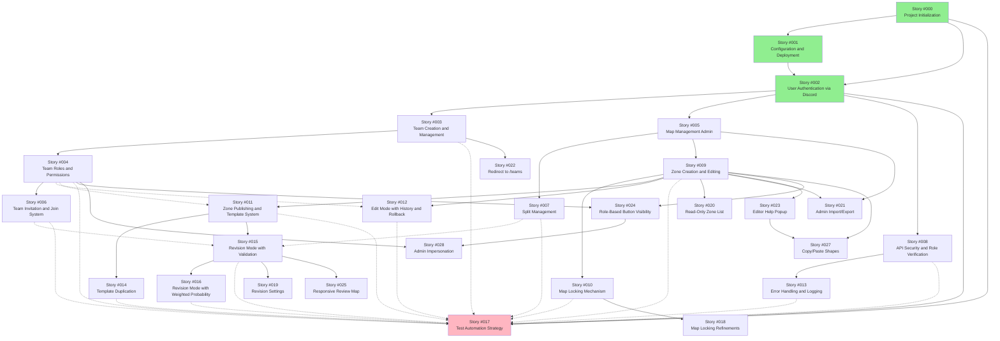
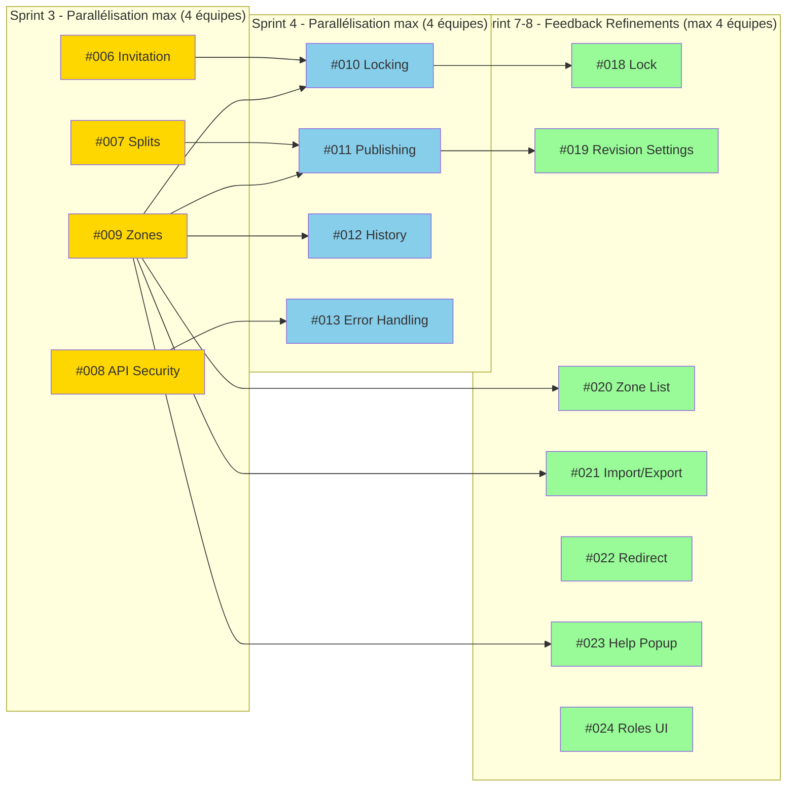

# Workflow d'implémentation des User Stories

Ce document définit l'ordre recommandé pour l'implémentation des user stories, en identifiant les dépendances et les opportunités de parallélisation.

## Légende
- 🔴 : Blocant (doit être fait avant)
- 🟡 : Peut être fait en parallèle
- 🟢 : Dépendance levée, peut commencer

---

## Phase 0 : Initialisation (Sprint 0 - 1 semaine)
*Mise en place de l'ossature du projet*

| Story | Titre | Dépendances | Tests E2E |
|-------|-------|-------------|------------|
| #000 | Project Initialization and Scaffolding | Aucune | - |

**Livrables :**
- Structure Go + Gin créée
- Frontend React + Vite + librairies installées
- docker-compose.yml fonctionnel
- Schéma de base de données initial créé
- Endpoint de santé `/health` opérationnel

---

## Phase 1 : Fondations (Sprint 1)
*Mise en place de l'infrastructure et de l'authentification de base*

### Parallélisation possible : 2 équipes/branches

| Story | Titre | Dépendances | Tests E2E |
|-------|-------|-------------|------------|
| #001 | Configuration and Deployment | #000 | - |
| #002 | User Authentication via Discord | #000 | Playwright |

**Livrables :**
- Environnement de développement configuré (Docker Compose)
- Authentification Discord fonctionnelle
- JWT + Refresh token avec rotation

---

## Phase 2 : Gestion des équipes - Base (Sprint 2)
*Création d'équipe et rôles de base*

| Story | Titre | Dépendances | Tests E2E |
|-------|-------|-------------|------------|
| #003 | Team Creation and Management | #002 (Auth) | Playwright |
| #004 | Team Roles and Permissions | #003 (Team) | Playwright |
| #005 | Map Management (Admin) | #002 (Auth) | Playwright |

**Notes :** 
- #003 et #005 peuvent démarrer en parallèles après #002
- #004 dépend de #003
- #002 dépend de #000 (initialisation)

---

## Phase 3 : Fonctionnalités équipe avancées (Sprint 3)
*Invitations, Splits, Sécurité API, Zones de base*

### Parallélisation possible : 4 équipes/branches

| Story | Titre | Dépendances | Tests E2E |
|-------|-------|-------------|------------|
| #006 | Team Invitation and Join System | #003, #004 | Playwright |
| #007 | Split Management and Filtering | #005 (Maps) | Playwright |
| #008 | API Security and Role Verification | #002, #004 | Playwright |
| #009 | Zone Creation and Editing with Polygons | #005, #004 | Playwright |

**Notes :**
- Ces 4 stories sont indépendantes entre elles une fois les dépendances levées
- Recommandé : 4 développeurs/branches différentes

---

## Phase 4 : Édition avancée et Publication (Sprint 4)
*Verrouillage, Templates, Historique, Gestion d'erreurs*

### Parallélisation possible : 4 équipes/branches

| Story | Titre | Dépendances | Tests E2E |
|-------|-------|-------------|------------|
| #010 | Map Locking Mechanism | #009 (Zones) | Playwright |
| #011 | Zone Publishing and Template System | #009, #004 | Playwright |
| #012 | Edit Mode with History and Rollback | #009, #004 | Playwright |
| #013 | Error Handling and Logging | #008 (API Security) | - |

**Notes :**
- #010, #011, #012 peuvent être développés en parallèle
- #013 peut être intégré progressivement dans les autres stories

---

## Phase 5 : Révision et Templates (Sprint 5)
*Duplication de templates et mode révision de base*

### Parallélisation possible : 2 équipes/branches

| Story | Titre | Dépendances | Tests E2E |
|-------|-------|-------------|------------|
| #014 | Template Duplication by Other Teams | #011 (Publish) | Playwright |
| #015 | Revision Mode with Validation | #009, #011 | Playwright |

**Notes :**
- #015 est le cœur de l'application, tester exhaustivement
- #014 complète le système de partage entre équipes

---

## Phase 6 : Révision avancée (Sprint 6)
*Algorithme de poids pour l'entraînement optimal*

| Story | Titre | Dépendances | Tests E2E |
|-------|-------|-------------|------------|
| #016 | Revision Mode with Weighted Probability | #015 (Revision) | Playwright |

**Notes :**
- Tests de charge recommandés pour valider l'algorithme de poids

---

## Phase 7 : Feedback-driven refinements (Sprint 7-8)
*Améliorations issues des feedbacks utilisateur du 2025-05-14*

### Parallélisation possible : 3 groupes

| Story | Titre | Dépendances | Tests E2E |
|-------|-------|-------------|------------|
| #018 | Map Locking Refinements | #010 (Locking) | Playwright |
| #019 | Revision Settings and Configurable Timers | #015 (Revision) | Playwright |
| #020 | Read-Only Zone List View | #009 (Zones) | Playwright |
| #021 | Admin Import/Export of Zones | #009, #005 | Playwright |
| #022 | Remove Homepage, Redirect to /teams | #003 (Teams) | Playwright |
| #023 | Editor Help Popup | #009 (Zones) | Playwright |
| #024 | Role-Based Editor Button Visibility | #004, #009 | Playwright |

**Groupes parallélisables :**
- **Groupe A** (UI éditeur) : #018, #020, #023, #024 — dépendent de #009/#010, indépendants entre eux
- **Groupe B** (Données) : #021 — dépend de #009, #005
- **Groupe C** (Parcours) : #022 — dépend de #003, peut être fait à tout moment après

**Notes :**
- #019 est bloquée par #015 (Revision), peut démarrer en parallèle du Groupe A si #015 est terminée
- Ces stories peuvent être implémentées en parallèle de #016 et #017

---

## Phase 8 : Finalisation des tests (Sprint 9)
*Couverture de tests à 100%*

| Story | Titre | Dépendances | Tests E2E |
|-------|-------|-------------|------------|
| #017 | Test Automation Strategy | Toutes les stories | Playwright |

**Notes :**
- Cette story est transversale et doit être intégrée tout au long
- Sprint dédié pour atteindre les 100% de couverture fonctionnelle

---

## Résumé du graphe de dépendances

---

## Phase 9 : Feedback-driven refinements (Sprint 9)
*Améliorations issues des feedbacks utilisateur du 2026-05-17*

### Parallélisation possible : 4 groupes

| Story | Titre | Dépendances | Tests E2E |
|-------|-------|-------------|------------|
| #025 | Responsive Review Map | #015 (Revision) | Playwright |
| #026 | App Title "Eva-Trainer" | Aucune | Playwright |
| #027 | Copy/Paste Shapes in Editor | #009, #023 | Playwright |
| #028 | Admin Impersonation Mode | #004, #024 | Playwright |

**Groupes parallélisables :**
- **Groupe A** (Révision) : #025 — dépend de #015
- **Groupe B** (Configuration) : #026 — aucune dépendance, peut être fait à tout moment
- **Groupe C** (Éditeur) : #027 — dépend de #009/#023
- **Groupe D** (Admin) : #028 — dépend de #004/#024

---

## Planning recommandé (11 Sprints : 0 à 10)

| Sprint | Stories | Équipe recommandée | Jalons |
|--------|---------|-------------------|--------|
| S0 | #000 | 1-2 devs | Project scaffolded |
| S1 | #001, #002 | 2 devs | Auth OK, Env OK |
| S2 | #003, #004, #005 | 3 devs | Teams OK, Maps OK |
| S3 | #006, #007, #008, #009 | 4 devs | Invitations, Splits, Zones |
| S4 | #010, #011, #012, #013 | 4 devs | Lock, Publish, History |
| S5 | #014, #015 | 2 devs | Templates, Revision |
| S6 | #016 | 1 dev | Weighted Revision |
| S7 | #018, #019, #020 | 2-3 devs | Lock refinements, Revision settings, Zone list |
| S8 | #021, #022, #023, #024 | 2-3 devs | Import/Export, Navigation, Help, Roles UI |
| S9 | #025, #026, #027, #028 | 2-3 devs | Responsive review, App title, Copy/paste, Impersonation |
| S10 | #017 + Tests | 2 devs | 100% Coverage |

**Total : 22 semaines (environ 5.5 mois)**

### Diagramme de Gantt (Mermaid)

```mermaid
gantt
    title Planning d'implémentation - 10 Sprints
    dateFormat  D
    axisFormat  Semaine %d
    
    section Phase 0 - Initialisation
    #000 Project Init                       :done, s0, 0, 10d
    
    section Phase 1 - Fondations
    #001 Configuration & Deployment        :done, s1a, after s0, 10d
    #002 Authentification Discord          :done, s1b, after s0, 10d
    
    section Phase 2 - Équipes base
    #003 Team Creation                     :active, s2a, after s1b, 10d
    #004 Team Roles                        :s2b, after s2a, 10d
    #005 Map Management                    :s2c, after s1b, 10d
    
    section Phase 3 - Fonctionnalités avancées
    #006 Invitation System                 :s3a, after s2b, 10d
    #007 Split Management                  :s3b, after s2c, 10d
    #008 API Security                      :s3c, after s1b, 10d
    #009 Zone Creation                     :s3d, after s2c, 10d
    
    section Phase 4 - Édition & Publication
    #010 Map Locking                       :s4a, after s3d, 10d
    #011 Zone Publishing                   :s4b, after s3d, 10d
    #012 Edit History & Rollback           :s4c, after s3d, 10d
    #013 Error Handling                    :s4d, after s3c, 10d
    
    section Phase 5 - Révision & Templates
    #014 Template Duplication              :s5a, after s4b, 10d
    #015 Revision Mode                     :s5b, after s4b, 10d
    
    section Phase 6 - Révision avancée
    #016 Weighted Probability              :s6, after s5b, 10d
    
    section Phase 7 - Feedback Refinements
    #018 Lock Refinements                  :s7a, after s4a, 10d
    #019 Revision Settings                 :s7b, after s5b, 10d
    #020 Read-Only Zone List               :s7c, after s3d, 10d
    
    section Phase 7b - Feedback Refinements (suite)
    #021 Import/Export                     :s8a, after s3d, 10d
    #022 Redirect to /teams                :s8b, after s2a, 10d
    #023 Editor Help Popup                 :s8c, after s3d, 10d
    #024 Role-Based Button                 :s8d, after s2b, 10d
    
    section Phase 9 - Feedback 2026-05-17
    #025 Responsive Review Map             :s9a, after s5b, 10d
    #026 App Title Eva-Trainer             :s9b, after s0, 5d
    #027 Copy/Paste Shapes                 :s9c, after s3d, 10d
    #028 Admin Impersonation               :s9d, after s2b, 10d
    
    section Phase 8 - Tests
    #017 Test Automation                   :s10, after s6, 10d
```

### Parallélisation maximale

---

## Notes importantes

0. **Story #000 - Ossature du projet** : Cette story est CRUCIALE et doit être terminée avant toute autre. Elle créée la structure de base (Go/Gin, React/Vite, Docker, PostgreSQL) sans laquelle les stories #001 et #002 ne peuvent pas être développées. Prévoyez une revue de code stricte sur cette ossature.

1. **Tests continus** : Story #017 ne doit pas attendre la fin. Chaque story doit inclure ses tests unitaires et d'intégration dès le Sprint 1.

2. **Démo après chaque Sprint** : Prévoir une démonstration fonctionnelle après chaque phase.

3. **Code Reviews** : Les stories en parallèle nécessitent des reviews croisées pour éviter les conflits de merge.

4. **Base de données** : Le schéma (`docs/specification/database_schema.md`) doit être validé avant le Sprint 2.

5. **Framework E2E** : Playwright doit être configuré dès le Sprint 0 (Story #000) pour être utilisé dès la Story #002.

6. **Feedbacks utilisateur (#018-#024)** : Ces stories proviennent des retours du 2025-05-14. Elles peuvent être implémentées dès que leurs dépendances sont résolues, sans attendre les phases suivantes.

7. **Feedbacks utilisateur (#025-#028)** : Ces stories proviennent des retours du 2026-05-17. #026 (App Title) n'a aucune dépendance et peut être fait à tout moment. #025 et #027 dépendent de fonctionnalités existantes.

8. **Stories #018-#028 non-bloquantes** : Aucune de ces stories ne bloque les stories du plan initial (#000-#017). Elles sont des améliorations indépendantes qui peuvent être priorisées selon la charge.
